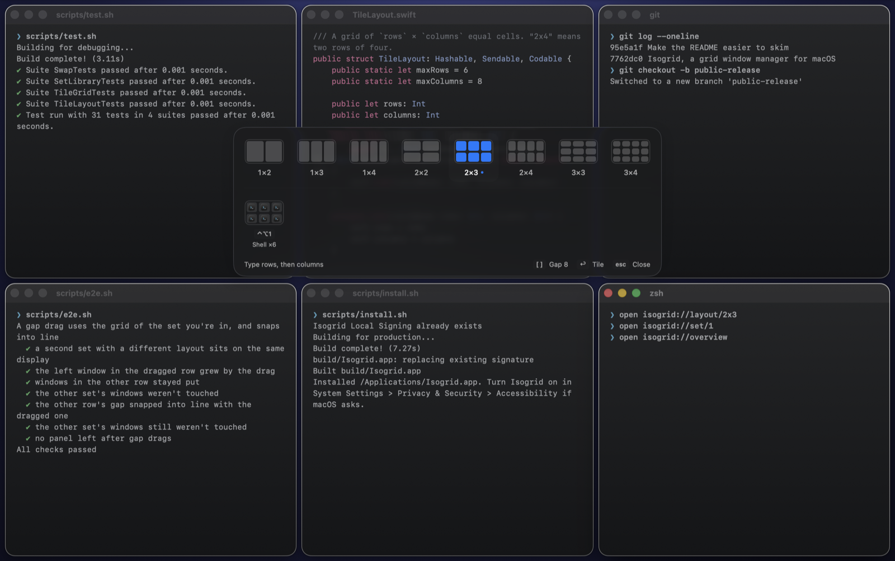

<p align="center">
  
</p>

# Isogrid

**A grid window manager for macOS, built for running many coding agents side by side.**

A menu bar app that keeps many windows visible at once: Claude Code windows, terminals and browsers in one grid. Tile with a keystroke, drop windows into cells, resize neighbours by dragging the gap between them, and bring a whole set back with one shortcut. No cloud, no telemetry, no AI (despite the hat).

Built on AppKit, SwiftUI and the Accessibility API. The app is about 2.4 MB.



---

## Install

Requires macOS 15 or later and Swift 6.2, from Xcode 26 or just its Command Line Tools (`xcode-select --install`).

```sh
git clone https://github.com/aaroi/isogrid.git
cd isogrid
scripts/install.sh
```

The script builds Isogrid, copies it to `/Applications` and opens it. Run it again to update.

On first launch macOS asks for **Accessibility** access, which Isogrid needs to move windows. Turn it on in System Settings › Privacy & Security › Accessibility. This is the only step an agent can't do for you.

macOS ties that grant to the app's code signature, so the script also creates a self-signed "Isogrid Local Signing" identity, in a keychain of its own, and signs every build with it. Updates then keep the grant instead of asking again. If Isogrid is switched on but can't move windows, its entry belongs to an earlier signature: remove it with −, add `/Applications/Isogrid.app` again with +, and switch it on.

**Screen Recording** is optional and only adds live previews to the overview.

## Shortcuts

| Keys | Action |
| --- | --- |
| ⌥G | Pick a layout. Type rows then columns (`24` is 2×4), or use the arrows and Return. |
| ⇧ + drag a window | Show the grid and drop the window into a cell. Dropping on a taken cell swaps the two. |
| Drag a gap | Resize the two windows beside it. Hold ⇧ to move the whole line. |
| ⌃⌥1 to ⌃⌥9 | Bring a set back to the front. |
| ⌃⌥Space | Overview of all sets. |

## Sets

- Every tiling saves its windows as a set, in slots 1 to 9.
- Focusing any window of a set raises the rest with it, including from ⌘Tab and Mission Control.
- Recalling a set restores minimized windows and moves stray ones back to their cells.
- Sets name themselves after their apps. Closed windows drop out.

## Details

- Applying a layout moves each window to the free cell nearest to it, so applying it twice moves nothing.
- Dragged gaps snap to other edges and even splits within 12 pt, and stop where a window can't get any narrower or shorter.
- Grids, sets and spacing are saved per display, and survive a monitor reconnecting under a new ID.
- The menu bar icon draws the current layout. Its menu sets the drag modifier, window spacing and Open at Login.

## Automate

Isogrid answers `isogrid://` URLs, for Raycast, Shortcuts or a shell:

```sh
open isogrid://layout/2x4   # set a layout and tile the display under the pointer
open isogrid://tile         # tile again
open isogrid://set/1        # bring set 1 forward
open isogrid://picker
open isogrid://overview
open isogrid://dismiss      # close the picker or overview
```

## Uninstall

```sh
pkill -x Isogrid; rm -rf /Applications/Isogrid.app
defaults delete dev.isogrid.Isogrid
tccutil reset All dev.isogrid.Isogrid
security delete-keychain ~/Library/Keychains/isogrid.keychain-db
```

## Develop

```sh
scripts/build.sh   # writes build/Isogrid.app
scripts/test.sh    # unit tests
scripts/e2e.sh     # end-to-end against real windows, about 20 s
```

The end-to-end test needs the Accessibility grant. It opens throwaway windows and drives a separate headless instance with its own settings, so your windows and sets are untouched. Leave the Mac alone while it runs.

| Path | Contents |
| --- | --- |
| `Sources/IsogridCore` | Grid geometry, gap dragging, snapping, swaps and the set library. No AppKit, fully unit tested. |
| `Sources/Isogrid/Windows` | Reading windows (`CGWindowList`) and moving them (Accessibility, off the main thread). |
| `Sources/Isogrid/Interaction` | Shortcuts, modifier drag, gap drag and group focus. |
| `Sources/Isogrid/Interface` | Overlay, picker, overview and menu. |
| `Sources/Isogrid/App` | Entry point, settings, tiling and the end-to-end test channel. |
| `Sources/isogrid-e2e`, `Sources/IsogridFixture` | The end-to-end test and the windows it drives. |

### Design notes

Each of these came from a failure in real use:

- Moves are rechecked after 80 and 220 ms, because some apps apply a resize late.
- macOS doesn't tell other apps how small a window can get. Isogrid learns it the first time a window refuses to shrink, moves the gap back to where it fits, and stops later drags there.
- Group focus only acts on focus that reads the same twice, 80 ms apart. Apps briefly report a stale window while you switch.
- The window that just lost focus is never raised, so closing one with ⌘W doesn't bring it back.
- Other apps' windows are raised without activating those apps, which avoids flicker.
- Full-screen panels close on a timer, never on an animation callback, so they can't get stuck over your screen.
- One private API is used, `_AXUIElementGetWindow`, the same one Rectangle and AltTab use.

## Credits

Window moving follows techniques from [Rectangle](https://github.com/rxhanson/Rectangle), see [THIRD_PARTY_NOTICES.md](THIRD_PARTY_NOTICES.md). MIT licensed, see [LICENSE](LICENSE).
